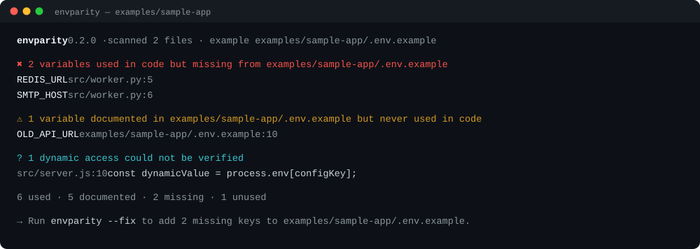

# envparity

**Keep your code and `.env.example` in parity.**

`envparity` reads your source code, finds every environment variable it actually
uses, and compares that with the example env file. Missing keys, stale entries
and dynamic lookups — reported in one pass, with file and line.

No config. No dependencies. No network. One command.

[](https://github.com/muhammaddani/envparity/actions/workflows/ci.yml)
[](LICENSE)



## The problem

Every project has a `.env.example`, and it drifts. Someone adds
`STRIPE_WEBHOOK_SECRET`, ships it, and the next person who clones the repo gets
a runtime crash instead of a list of what to fill in. Meanwhile `OLD_S3_BUCKET`
stays in the example for two years after the feature was deleted.

`envparity` compares both sides and reports the gap:

```
✖ 2 variables used in code but missing from .env.example
    REDIS_URL               src/worker.py:5
    SMTP_HOST               src/worker.py:6

⚠ 1 variable documented in .env.example but never used in code
    OLD_API_URL             .env.example:10
```

## Quick start

```bash
# run once, no install
npx envparity

# or install it in the project
npm install --save-dev envparity

# fail CI when the example file is behind
npx envparity --strict
```

`envparity` auto-detects `.env.example`, `.env.sample`, `.env.template`,
`.env.dist`, `.env.defaults`, `env.example`, and `example.env`.

## What it reports

| Section | Meaning |
| --- | --- |
| **missing** | Read in code, absent from the example file. The one that breaks fresh clones. |
| **unused** | Present in the example file and referenced nowhere. Stale documentation. |
| **indirect** | Documented, not read by source code, but referenced in a manifest, compose file, template or as a helper literal. |
| **undeclared** | Read in code, absent from a real env file (only with `--env .env`). |
| **dynamic** | `process.env[name]` style access. Listed so you can check it by hand; never invented. |

Values are never read, printed, or transmitted. Only key names and line numbers
leave the process.

The **indirect** section is what makes the unused check usable: a key consumed
by `docker-compose.yml`, `turbo.json`, `app.json` or an ERB template is not left
behind, and a key read through a helper such as
`this.toOptionalString("CDN_URL")` is recognised instead of being called stale.

## Accuracy

Audited against nine real open-source projects (37,661 files): **1,501 variables
read, 1,178 missing, 7 stale entries**. All seven look like genuine drift — on
Plane, every flagged key is marked `# deprecated` in the example file.

The audit is what shaped the extractor: the first version reported 151 stale
entries, 95% of which were detection gaps (`environment.FOO` aliases,
django-environ, NestJS `configService.get`, helper literals, ERB templates).
Full method, corpus and limits: **[docs/ACCURACY.md](docs/ACCURACY.md)**.

## Usage

```
envparity [path] [options]

Options
  -e, --example <file>    example env file to check against
                          (default: auto-detect .env.example, .env.sample, ...)
      --env <file>        also verify keys exist in a real env file (e.g. .env)
      --fix               append missing keys to the example file
      --strict            exit 1 when variables are missing or undeclared
      --json              print a machine-readable report
      --ignore <list>     comma-separated key globs to ignore (e.g. CI,AWS_*)
      --ignore-file <f>   read ignored keys/globs from a file (one per line)
      --include <list>    comma-separated globs of files to scan
      --exclude <list>    comma-separated globs of files or folders to skip
      --max-size <bytes>  skip files larger than this (default: 1048576)
      --no-color          disable colored output
  -h, --help              show this help
  -v, --version           print the version
```

### Exit codes

| Code | When |
| --- | --- |
| `0` | No blocking findings (or findings without `--strict`) |
| `1` | Findings were reported and `--strict` was set |
| `2` | Invalid usage, missing directory, or unreadable input |

`--strict` fails on **missing** and **undeclared** only. Stale documentation is
reported but never breaks a build.

### `--fix`

Appends `KEY=` lines for missing variables without touching what you already wrote:

```diff
  # Node server
  PORT=3000
  DATABASE_URL=postgres://localhost:5432/app
+
+ # Added by envparity
+ REDIS_URL=
+ SMTP_HOST=
```

Running it twice changes nothing.

### Monorepos

```bash
envparity apps/web --strict
envparity apps/api --example ../../.env.example
envparity . --include "packages/*/src/**" --exclude "**/*.test.js"
```

On a large repository, most findings live in tests and scripts. The report shows
the split, and you can narrow it:

```bash
envparity --exclude "**/*.test.*,**/__tests__/**,e2e/**,docs/**"
```

## pre-commit

`.pre-commit-hooks.yaml` is included, so:

```yaml
repos:
  - repo: https://github.com/muhammaddani/envparity
    rev: v1
    hooks:
      - id: envparity
      # or let it update .env.example for you:
      # - id: envparity-fix
```

## GitHub Action

```yaml
name: ci
on: [push, pull_request]

jobs:
  env:
    runs-on: ubuntu-latest
    steps:
      - uses: actions/checkout@v7
      - uses: muhammaddani/envparity@v1
        with:
          path: .
          strict: "true"
```

Inputs: `path`, `example`, `strict` (default `true`), `fix`, `args`.

## Supported languages

| Language | Patterns understood |
| --- | --- |
| JavaScript / TypeScript / JSX / TSX / Vue / Svelte | `process.env.FOO`, `process.env["FOO"]`, `import.meta.env.FOO`, `Deno.env.get("FOO")`, `configService.get("FOO")`, `env.FOO` / `environment.FOO` aliases |
| Python | `os.environ["FOO"]`, `os.environ.get("FOO")`, `os.getenv("FOO")`, django-environ `env("FOO")` |
| Go | `os.Getenv("FOO")`, `os.LookupEnv("FOO")` |
| Rust | `env::var("FOO")`, `env::var_os("FOO")`, `option_env!("FOO")` |
| Ruby | `ENV["FOO"]`, `ENV.fetch("FOO")`, including `.erb` templates |
| PHP | `getenv("FOO")`, `$_ENV["FOO"]`, Laravel `env("FOO")` |
| Java / Kotlin / Scala | `System.getenv("FOO")`, Spring `@Value("${FOO}")` |
| C# | `Environment.GetEnvironmentVariable("FOO")` |
| C / C++ | `getenv("FOO")` |
| Elixir | `System.get_env("FOO")` |
| Dart | `String.fromEnvironment("FOO")`, `Platform.environment["FOO"]` |
| Shell / Dockerfile / Compose | `${FOO}`, `${FOO:-default}`, `${FOO:?message}` |

Generated folders (`node_modules`, `dist`, `build`, `coverage`, `.next`,
`target`, `vendor`, virtualenvs, …) are skipped automatically.

Variables are only collected when the name looks like a constant
(`^[A-Z][A-Z0-9_]*$`), which keeps `process.env[key]` and `config.env.FOO` out
of the results.

## How it compares

| | envparity | dotenv-linter | dotenv-checker | varlock | t3-env |
| --- | --- | --- | --- | --- | --- |
| Reads env usage from application code | ✅ | ❌ file-level only | ✅ Node only | schema-first | ❌ runtime validation |
| Compares code against `.env.example` | ✅ | ❌ (`.env` vs `.env.example`) | ✅ | schema-based | ❌ |
| Flags documented but never used | ✅ | partial | ❌ | ❌ | ❌ |
| Multi-language | ✅ 14 | n/a | ❌ | ❌ | ❌ |
| Zero config | ✅ | ✅ | ❌ | ❌ | ❌ |
| Auto-fix `.env.example` | ✅ | ❌ | ✅ | ❌ | n/a |
| GitHub Action | ✅ | ✅ | ❌ | ❌ | n/a |
| Runtime dependencies | 0 | 0 (Rust binary) | several | several | several |

`dotenv-linter` validates the `.env` file itself (ordering, duplicates, quotes)
and `envparity` checks whether the file matches the code. They are complementary
— running both is reasonable.

## Programmatic API

```js
import { readFile } from "node:fs/promises";
import { analyze, parseDotenv, scanProject } from "envparity";

const scan = await scanProject(".");
const example = parseDotenv(await readFile(".env.example", "utf8"));
const report = analyze({
  usages: scan.usages,
  dynamic: scan.dynamic,
  example,
  mentions: scan.mentions,
});

console.log(report.missing);
```

## Ignoring variables

Some variables are provided by the platform (`CI`, `AWS_REGION`, `VERCEL_*`)
and are not worth documenting:

```bash
envparity --ignore "CI,AWS_*,VERCEL_*"
```

```text
# .envparityignore
CI
AWS_*
VERCEL_*
```

```bash
envparity --ignore-file .envparityignore
```

## How it works

`envparity` is a single pass of pattern matching over text files, run through a
bounded async pool. It never executes your code, never loads plugins, and never
makes a network request. That makes it fast enough for a pre-commit hook (1.3 s
for 2,470 files, 4.1 s for 8,291 on Windows) and safe enough to run on untrusted
repositories.

The trade-off: it does not resolve aliases across modules, re-exports, or
configuration indirection. When it cannot see the key, it says so in the
**dynamic** section instead of guessing.

Known limits:

- Env access through an unrelated wrapper name is reported as `indirect` when
  the key appears as a string literal, and missed when it does not.
- Reads inside block comments are ignored for C-style languages; string
  literals that contain `process.env.X` can still produce a false positive.
- Only `UPPER_SNAKE_CASE` keys are collected.

## Development

```bash
npm test          # 59 tests, node:test, zero dependencies
npm run demo      # run against examples/sample-app
npm run self-check
```

See [CONTRIBUTING.md](CONTRIBUTING.md).

## License

[MIT](LICENSE) © Muhammad Dani Noar
